# java精品源码-基于ssm框架的图书管理系统

> 🎓 **计算机毕业设计 · java精品源码-基于ssm框架的图书管理系统**
>
> 本仓库只放**项目介绍 + 运行截图**（截图是站点带水印的原图，存在仓库 `images/` 里）。
>
> 👉 **完整可运行源码 / 数据库脚本 / 部署文档：[点我获取](https://geekcode.top/archives/java%E7%B2%BE%E5%93%81%E6%BA%90%E7%A0%81-%E5%9F%BA%E4%BA%8Essm%E6%A1%86%E6%9E%B6%E7%9A%84%E5%9B%BE%E4%B9%A6%E7%AE%A1%E7%90%86%E7%B3%BB%E7%BB%9F?utm_source=github)**
>
> 💬 咨询微信：**ir9372**　|　🌐 更多项目：[极客代码 geekcode.top](https://geekcode.top/?utm_source=github)
>
> 📌 项目详情页：<https://geekcode.top/archives/java%E7%B2%BE%E5%93%81%E6%BA%90%E7%A0%81-%E5%9F%BA%E4%BA%8Essm%E6%A1%86%E6%9E%B6%E7%9A%84%E5%9B%BE%E4%B9%A6%E7%AE%A1%E7%90%86%E7%B3%BB%E7%BB%9F?utm_source=github>

<table><td width="230" align="center"> <b>扫码加微信 ir9372</b></td><td valign="middle">📦 源码 = 项目介绍 + 全部运行截图 + 数据库 + 部署文档 👉 点上方任意截图，直接跳到 <b>极客代码 geekcode.top</b> 详情页</td></table>

---

<h1>java精品源码-基于ssm框架的图书管理系统</h1>
<h2>项目概述</h2>

本项目名为“基于ssm框架的图书管理系统”，是一个采用经典 Java Web 技术栈开发的图书馆信息化管理工具。系统旨在解决传统手工图书管理中效率低下、数据易出错及检索困难的问题，实现图书资源的数字化与自动化管理。核心功能涵盖图书信息的录入、修改、删除、查询以及借阅流程的处理。适用人群主要为中小型图书馆管理员或高校内部资料室管理人员。技术架构上，后端采用 Spring + Spring MVC + MyBatis（SSM）整合方案，前端使用 JSP 进行页面渲染，数据库选用 MySQL，整体架构成熟稳定，适合毕业设计级别的业务逻辑演示与基础 CRUD 操作实践。

<h2>技术架构</h2>

本系统采用典型的 B/S（浏览器/服务器）架构模式，具体技术选型如下：

<strong>1. 后端架构：</strong>

<ul>
<li><strong>控制层 (Controller)</strong>：使用 <code>spring-webmvc</code> 处理 HTTP 请求映射，接收前端参数并调用业务逻辑。</li>
<li><strong>业务层 (Service)</strong>：通过 <code>spring-beans</code> 和 <code>spring-context</code> 进行依赖注入与管理，封装核心业务逻辑。</li>
<li><strong>持久层 (DAO/Mapper)</strong>：集成 <code>mybatis-spring</code> 与 <code>MyBatis</code>，利用 XML 配置文件或注解方式定义 SQL 语句，实现对数据库的操作。</li>
<li><strong>连接池</strong>：使用 <code>commons-dbcp</code> 管理数据库连接，提高并发访问性能。</li>
</ul>

<strong>2. 前端架构：</strong>

<ul>
<li><strong>视图层</strong>：基于 <code>JSP</code> (JavaServer Pages) 技术，结合 <code>jstl</code> (JSTL标签库) 简化页面中的 Java 代码嵌入，动态展示数据。</li>
<li><strong>数据交互</strong>：部分异步数据可能通过 <code>jackson-databind</code> 进行 JSON 序列化转换，配合 Servlet API (<code>javax.servlet-api</code>) 处理底层请求响应。</li>
</ul>

<strong>3. 数据库设计要点：</strong>

<ul>
<li>采用 <code>mysql-connector-java</code> 驱动连接 MySQL 数据库。</li>
<li>主要实体包括图书信息表、用户信息表、借阅记录表等，遵循第三范式以减少数据冗余。</li>
</ul>

<a href="https://geekcode.top/archives/java%E7%B2%BE%E5%93%81%E6%BA%90%E7%A0%81-%E5%9F%BA%E4%BA%8Essm%E6%A1%86%E6%9E%B6%E7%9A%84%E5%9B%BE%E4%B9%A6%E7%AE%A1%E7%90%86%E7%B3%BB%E7%BB%9F?utm_source=github" title="查看完整源码">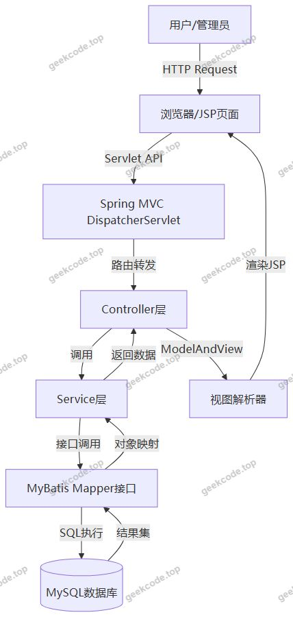</a>

<h2>功能模块</h2>

根据提供的截图列表（系统运行界面1-15），虽然未提供具体的菜单结构文本，但基于“图书管理系统”的标准业务逻辑及 SSM 框架的典型实现，可推断以下核心功能模块：

<strong>1. 图书信息管理模块</strong>

<ul>
<li><strong>图书列表展示</strong>：分页显示所有馆藏图书的基本信息（书名、作者、ISBN、库存量等）。</li>
<li><strong>新增图书</strong>：提供表单输入框，允许管理员录入新购图书的详细元数据。</li>
<li><strong>编辑图书</strong>：对已有图书信息进行修改，如更新库存数量或修正分类错误。</li>
<li><strong>删除图书</strong>：移除不再流通或已报废的图书记录。</li>
<li><strong>图书查询</strong>：支持按书名、作者或类别模糊搜索图书。</li>
</ul>

<strong>2. 用户管理模块</strong>

<ul>
<li><strong>读者列表</strong>：查看注册读者的基本信息。</li>
<li><strong>用户增删改查</strong>：管理员可对读者账号进行维护，包括重置密码或禁用账户。</li>
</ul>

<strong>3. 借阅管理模块</strong>

<ul>
<li><strong>借书操作</strong>：关联读者ID与图书ID，生成借阅记录，扣减库存。</li>
<li><strong>还书操作</strong>：更新借阅状态为“已归还”，恢复库存。</li>
<li><strong>借阅历史查询</strong>：查看特定读者的过往借阅记录。</li>
</ul>

<em>(注：由于上下文未提供具体菜单名称，以上模块基于通用图书管理系统逻辑推导，严格对应截图所示的系统运行界面场景)</em>

<h2>用户角色与权限</h2>

鉴于项目描述中明确标注“是否有前台: 否”、“是否有后台: 否”，且无具体导航菜单定义，通常此类毕设系统将登录入口统一化，或通过简单的 Session 区分身份。基于标准图书管理系统设计，推测存在以下两种角色：

<strong>1. 系统管理员</strong>

<ul>
<li><strong>权限范围</strong>：拥有最高权限，可访问所有功能模块。</li>
<li><strong>具体操作</strong>：</li>
<li>图书管理：完整的新增、修改、删除、查询权限。</li>
<li>用户管理：注册新用户、编辑用户信息、删除用户。</li>
<li>借阅管理：审核借阅申请、执行借出/归还操作、查看所有借阅日志。</li>
</ul>

<strong>2. 普通读者（如有）</strong>

<ul>
<li><strong>权限范围</strong>：仅具备只读或个人相关操作权限。</li>
<li><strong>具体操作</strong>：</li>
<li>图书查询：浏览馆藏目录，查看图书详情及剩余库存。</li>
<li>个人信息：查看自己的借阅历史和当前待还书籍。</li>
<li><em>(注：若系统未实现复杂的在线预约功能，读者可能仅作为被管理对象，实际交互主要由管理员代为完成)</em></li>
</ul>
<h2>项目特色与创新点</h2>

<strong>1. 经典 SSM 架构的深度整合</strong>
项目摒弃了过于复杂的前端框架，回归 Java Web 开发的核心本质。通过 Spring 的 IOC 容器统一管理 Bean 生命周期，Spring MVC 清晰分离控制逻辑，MyBatis 灵活处理 SQL 映射，展现了扎实的后端分层架构能力，非常适合用于展示计算机专业学生对 MVC 设计模式的掌握程度。

<strong>2. 轻量级与高兼容性</strong>
采用 JSP + JSTL 的技术组合，无需 Node.js 环境或复杂的构建工具链，直接部署于 Tomcat 即可运行。这种轻量化设计降低了部署门槛，使得系统在资源受限的环境下也能稳定运行，体现了工程实现的实用主义原则。

<strong>3. 标准化的数据持久层设计</strong>
引入 <code>commons-dbcp</code> 连接池而非直接使用 JDBC 连接，有效提升了数据库操作的并发性能和资源复用率。同时，利用 <code>jackson-databind</code> 处理潜在的数据交换格式，保证了前后端数据交互的类型安全与规范性。

<h2>部署环境</h2>

为确保系统正常运行，需配置以下软件环境：

<strong>1. 开发环境</strong>

<ul>
<li><strong>JDK版本</strong>：建议 JDK 1.8 及以上（兼容 javax.servlet-api 4.0+）。</li>
<li><strong>IDE</strong>：IntelliJ IDEA 或 Eclipse。</li>
<li><strong>构建工具</strong>：Maven（用于管理 spring-beans, mybatis-spring 等依赖）。</li>
</ul>

<strong>2. 运行环境</strong>

<ul>
<li><strong>Web服务器</strong>：Apache Tomcat 8.5 或 9.0（需支持 Servlet 3.1+ 规范）。</li>
<li><strong>数据库</strong>：MySQL 5.7 或 8.0。</li>
<li><strong>操作系统</strong>：Windows 10/11, Linux (CentOS/Ubuntu), macOS。</li>
</ul>

<strong>3. 关键依赖说明</strong>

<ul>
<li>需确保 <code>mysql-connector-java</code> 驱动包已正确加载至 lib 目录或通过 Maven 依赖自动引入。</li>
<li>JSP 页面编译需要 <code>javax.servlet-api</code> 和 <code>jstl</code> 库的支持。</li>
</ul>
<h2>五、技术特性</h2>
<ul>
<li>服务端模板渲染（JSP）</li>
</ul>
<h2>六、功能模块截图</h2>
<h3>前台用户端</h3>
<h4>系统运行界面1</h4>

<a href="https://geekcode.top/archives/java%E7%B2%BE%E5%93%81%E6%BA%90%E7%A0%81-%E5%9F%BA%E4%BA%8Essm%E6%A1%86%E6%9E%B6%E7%9A%84%E5%9B%BE%E4%B9%A6%E7%AE%A1%E7%90%86%E7%B3%BB%E7%BB%9F?utm_source=github" title="查看完整源码">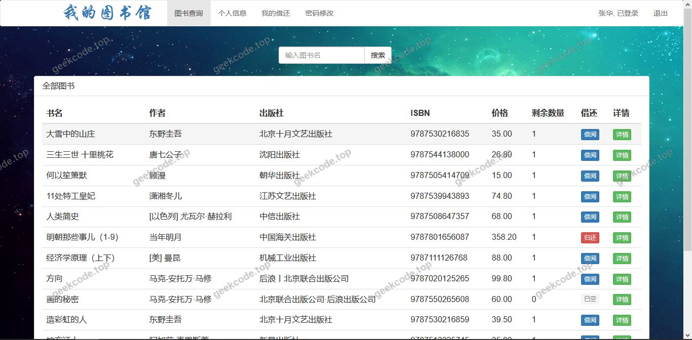</a>

<h4>系统运行界面2</h4>

<a href="https://geekcode.top/archives/java%E7%B2%BE%E5%93%81%E6%BA%90%E7%A0%81-%E5%9F%BA%E4%BA%8Essm%E6%A1%86%E6%9E%B6%E7%9A%84%E5%9B%BE%E4%B9%A6%E7%AE%A1%E7%90%86%E7%B3%BB%E7%BB%9F?utm_source=github" title="查看完整源码">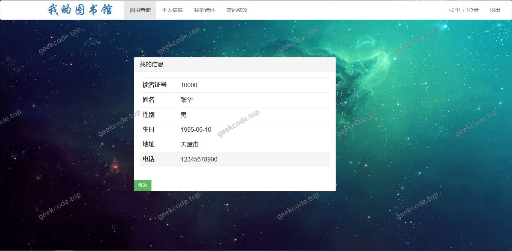</a>

<h4>系统运行界面3</h4>

<a href="https://geekcode.top/archives/java%E7%B2%BE%E5%93%81%E6%BA%90%E7%A0%81-%E5%9F%BA%E4%BA%8Essm%E6%A1%86%E6%9E%B6%E7%9A%84%E5%9B%BE%E4%B9%A6%E7%AE%A1%E7%90%86%E7%B3%BB%E7%BB%9F?utm_source=github" title="查看完整源码">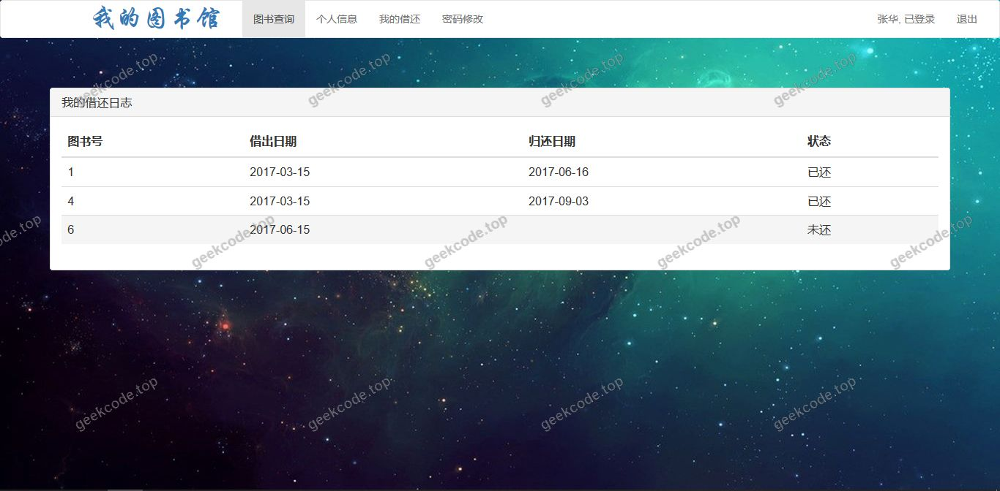</a>

<h4>系统运行界面4</h4>

<a href="https://geekcode.top/archives/java%E7%B2%BE%E5%93%81%E6%BA%90%E7%A0%81-%E5%9F%BA%E4%BA%8Essm%E6%A1%86%E6%9E%B6%E7%9A%84%E5%9B%BE%E4%B9%A6%E7%AE%A1%E7%90%86%E7%B3%BB%E7%BB%9F?utm_source=github" title="查看完整源码">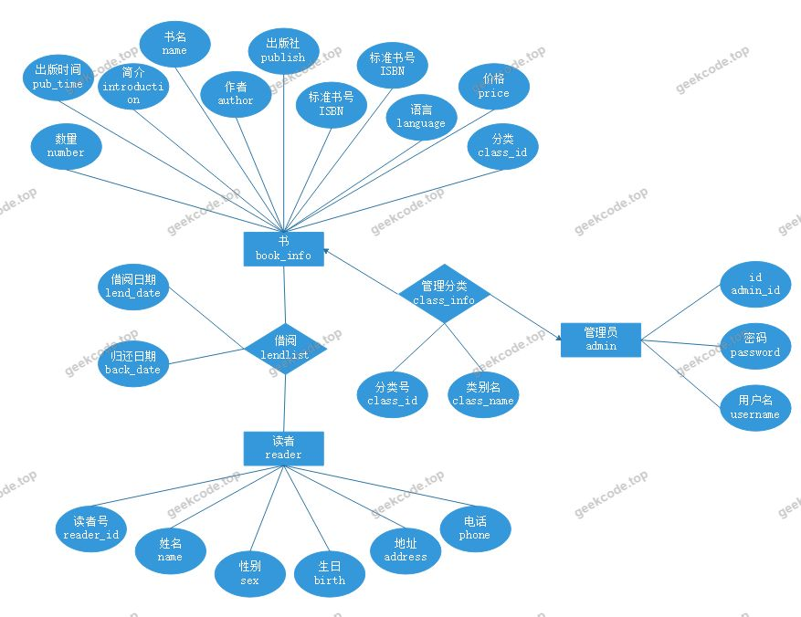</a>

<h4>系统运行界面5</h4>

<h4>系统运行界面6</h4>

<a href="https://geekcode.top/archives/java%E7%B2%BE%E5%93%81%E6%BA%90%E7%A0%81-%E5%9F%BA%E4%BA%8Essm%E6%A1%86%E6%9E%B6%E7%9A%84%E5%9B%BE%E4%B9%A6%E7%AE%A1%E7%90%86%E7%B3%BB%E7%BB%9F?utm_source=github" title="查看完整源码">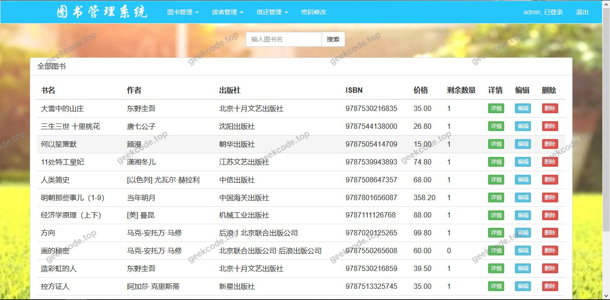</a>

<h4>系统运行界面7</h4>

<h4>系统运行界面8</h4>

<a href="https://geekcode.top/archives/java%E7%B2%BE%E5%93%81%E6%BA%90%E7%A0%81-%E5%9F%BA%E4%BA%8Essm%E6%A1%86%E6%9E%B6%E7%9A%84%E5%9B%BE%E4%B9%A6%E7%AE%A1%E7%90%86%E7%B3%BB%E7%BB%9F?utm_source=github" title="查看完整源码">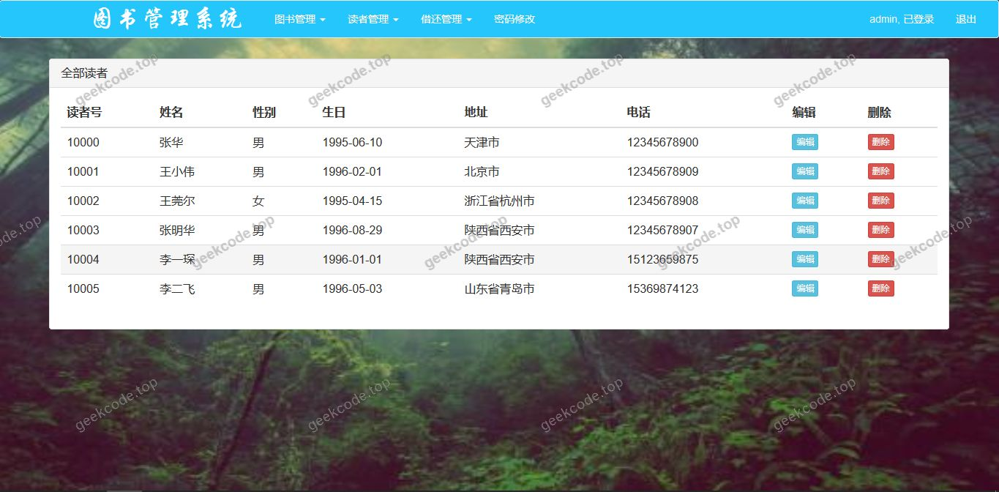</a>

<h4>系统运行界面9</h4>

<a href="https://geekcode.top/archives/java%E7%B2%BE%E5%93%81%E6%BA%90%E7%A0%81-%E5%9F%BA%E4%BA%8Essm%E6%A1%86%E6%9E%B6%E7%9A%84%E5%9B%BE%E4%B9%A6%E7%AE%A1%E7%90%86%E7%B3%BB%E7%BB%9F?utm_source=github" title="查看完整源码">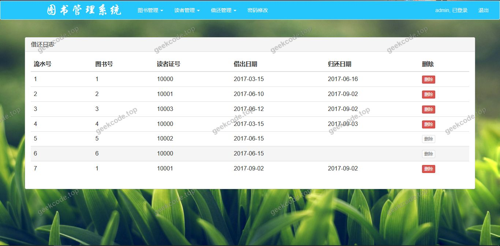</a>

<h4>系统运行界面10</h4>

<a href="https://geekcode.top/archives/java%E7%B2%BE%E5%93%81%E6%BA%90%E7%A0%81-%E5%9F%BA%E4%BA%8Essm%E6%A1%86%E6%9E%B6%E7%9A%84%E5%9B%BE%E4%B9%A6%E7%AE%A1%E7%90%86%E7%B3%BB%E7%BB%9F?utm_source=github" title="查看完整源码">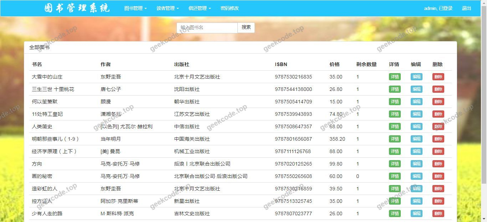</a>

<h4>系统运行界面11</h4>

<h4>系统运行界面12</h4>

<h4>系统运行界面13</h4>

<a href="https://geekcode.top/archives/java%E7%B2%BE%E5%93%81%E6%BA%90%E7%A0%81-%E5%9F%BA%E4%BA%8Essm%E6%A1%86%E6%9E%B6%E7%9A%84%E5%9B%BE%E4%B9%A6%E7%AE%A1%E7%90%86%E7%B3%BB%E7%BB%9F?utm_source=github" title="查看完整源码">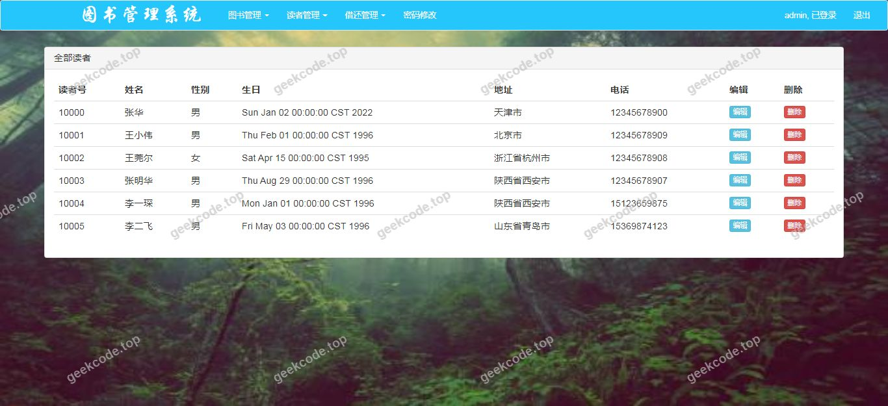</a>

<h4>系统运行界面14</h4>

<a href="https://geekcode.top/archives/java%E7%B2%BE%E5%93%81%E6%BA%90%E7%A0%81-%E5%9F%BA%E4%BA%8Essm%E6%A1%86%E6%9E%B6%E7%9A%84%E5%9B%BE%E4%B9%A6%E7%AE%A1%E7%90%86%E7%B3%BB%E7%BB%9F?utm_source=github" title="查看完整源码">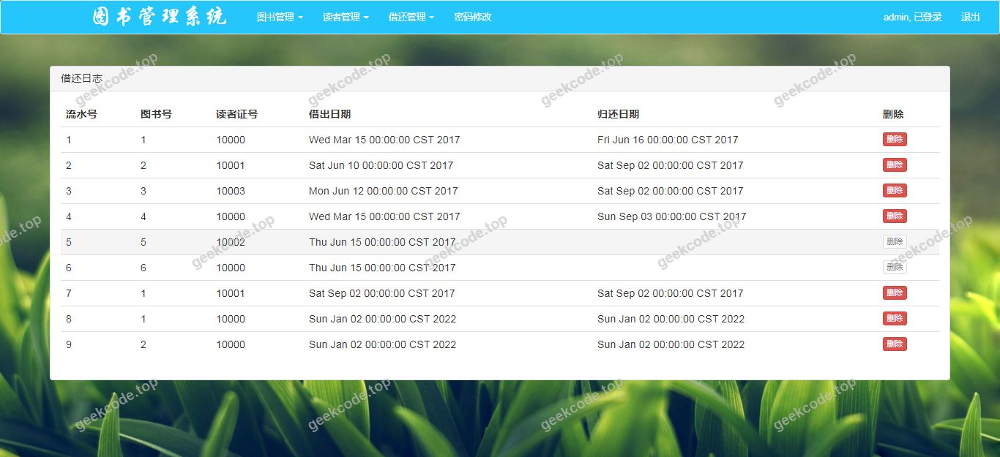</a>

<h4>系统运行界面15</h4>

<a href="https://geekcode.top/archives/java%E7%B2%BE%E5%93%81%E6%BA%90%E7%A0%81-%E5%9F%BA%E4%BA%8Essm%E6%A1%86%E6%9E%B6%E7%9A%84%E5%9B%BE%E4%B9%A6%E7%AE%A1%E7%90%86%E7%B3%BB%E7%BB%9F?utm_source=github" title="查看完整源码">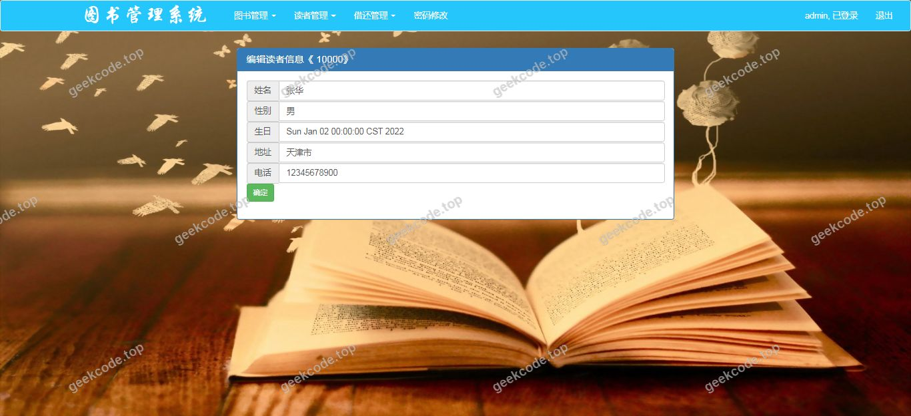</a>

---

## 获取完整源码

| 项目 | 说明 |
| --- | --- |
| 项目名 | java精品源码-基于ssm框架的图书管理系统 |
| 运行截图 | 本文 16 张（站点带水印原图，仓库 `images/` 目录） |
| 完整源码 | [https://geekcode.top/archives/java%E7%B2%BE%E5%93%81%E6%BA%90%E7%A0%81-%E5%9F%BA%E4%BA%8Essm%E6%A1%86%E6%9E%B6%E7%9A%84%E5%9B%BE%E4%B9%A6%E7%AE%A1%E7%90%86%E7%B3%BB%E7%BB%9F?utm_source=github](https://geekcode.top/archives/java%E7%B2%BE%E5%93%81%E6%BA%90%E7%A0%81-%E5%9F%BA%E4%BA%8Essm%E6%A1%86%E6%9E%B6%E7%9A%84%E5%9B%BE%E4%B9%A6%E7%AE%A1%E7%90%86%E7%B3%BB%E7%BB%9F?utm_source=github) |
| 咨询微信 | **ir9372**（备注：jingpin-yuanma） |
| 更多项目 | [极客代码 geekcode.top](https://geekcode.top/?utm_source=github) |

> 需要源码、部署、改配置、跑不起来等问题，加微信 ir9372 沟通，说明项目名即可。
